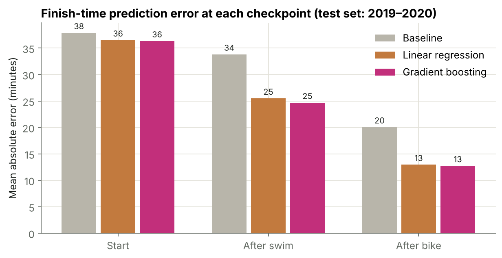
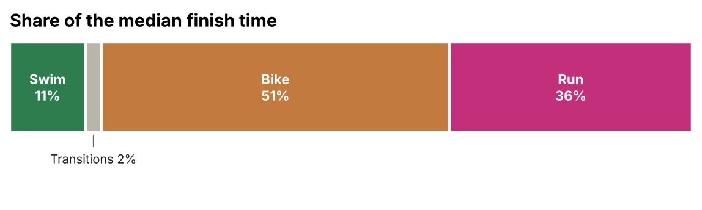
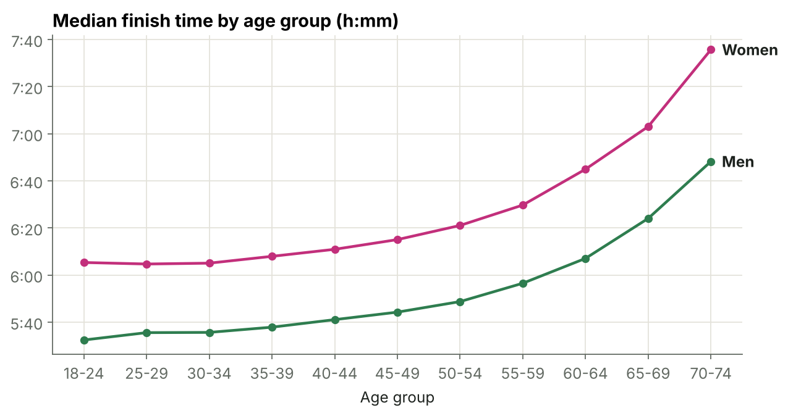
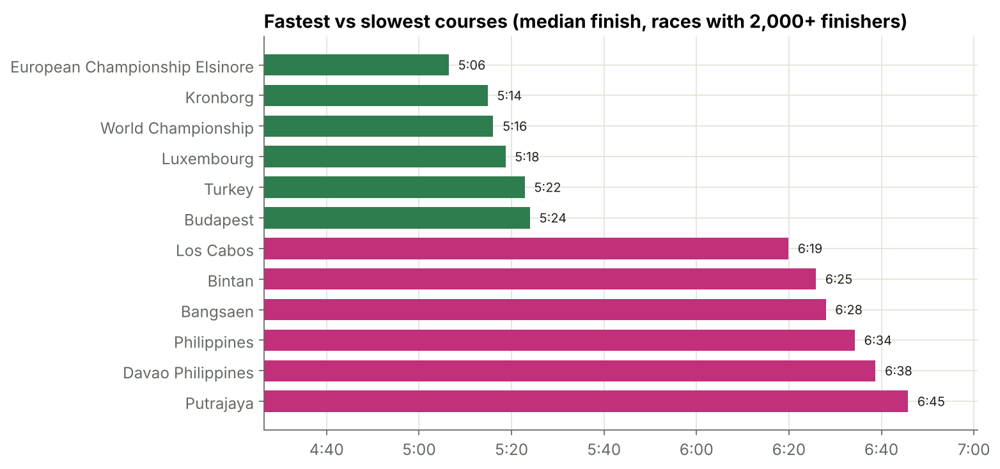
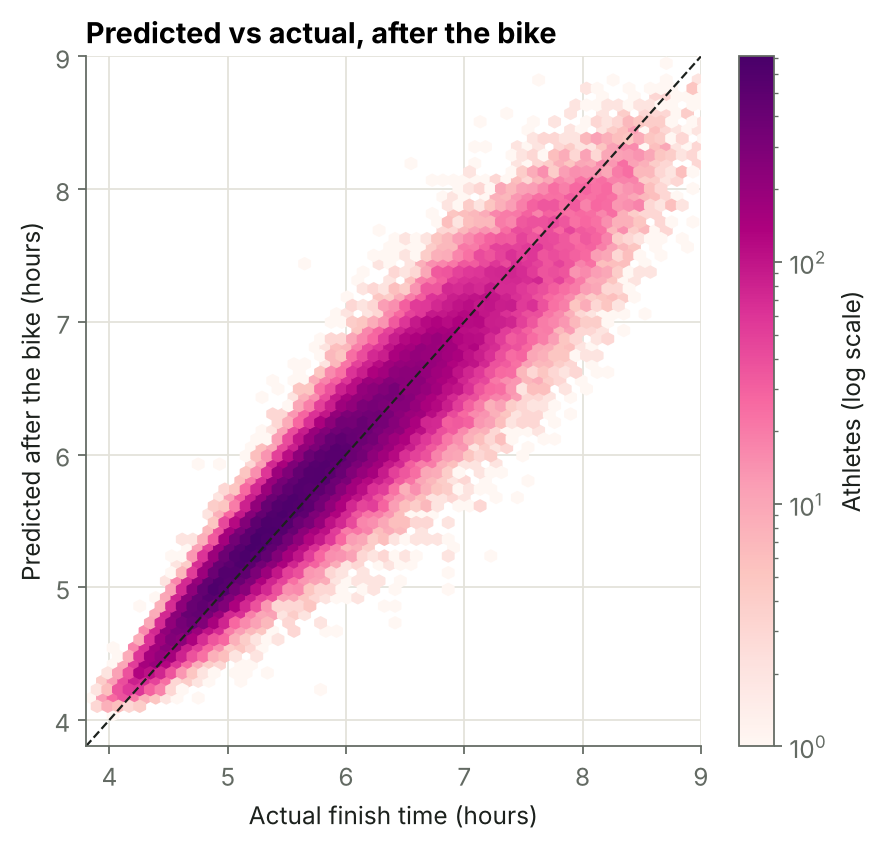
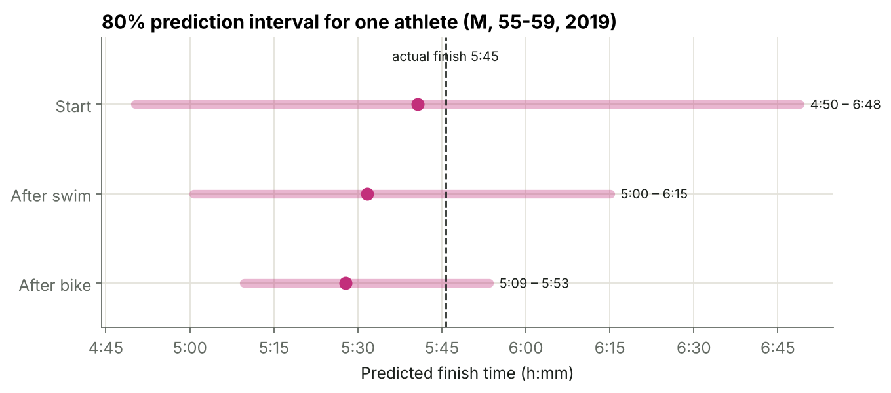

# Ironman 70.3: what decides a finish time, and can we predict it mid-race?

Analysis of **823,000+ Ironman 70.3 results** (195 races, 2004–2020) and a model that predicts an athlete's
**final finish time while the race is still running**: at the start, after the swim and after the bike.



## Key results

| Checkpoint | Baseline | Linear regression | Gradient boosting | R² (boosting) |
|---|---|---|---|---|
| Start | 37.9 min | 36.5 min | **36.3 min** | 0.18 |
| After swim | 33.8 min | 25.5 min | **24.7 min** | 0.61 |
| After bike | 20.0 min | 12.9 min | **12.7 min** | 0.89 |

*Mean absolute error of the predicted finish time. Trained on 2004–2018 races, tested on 2019–2020 races.*

* **After the bike, 49% of athletes are predicted within ±10 minutes and 80% within ±20 minutes.**
* **The model knows how sure it is.** It also gives an 80% prediction interval (conformalized quantile regression).
  On the test races, 79% of athletes finish inside it, and it shrinks from about 2 hours at the start to about 40 minutes after the bike.
* **The bike and the run decide the race.** The bike is 51% of the median finish time, the run 36%, the swim only 11%.
* **The course matters a lot.** Median finish times differ by about 1 h 40 min between the fastest and slowest courses.
* **More information beats a more complex model.** Gradient boosting is only slightly better than linear regression;
  the big improvement comes from each new checkpoint.

| | |
|---|---|
|  |  |
|  |  |



## Approach

1. **Cleaning:** removed results with unknown age (`AgeGroup = "00"`, 2% of rows) and 17 duplicate rows, and checked that the segment times add up to the finish time.
   The raw file is sorted by country, so the full dataset is used instead of the first N rows.
2. **Exploration:** growth of the sport, how the finish time is split between disciplines, age and gender effects, course difficulty.
3. **Live prediction:** for each checkpoint, three models predict the finish time:
   * **Baseline:** time already raced + median time of the remaining legs for the same gender and age group
   * **Linear regression** with one-hot encoded course
   * **Gradient boosting** (`HistGradientBoostingRegressor`) with the course as a categorical feature
4. **Uncertainty:** quantile gradient boosting (10th and 90th percentile) gives an 80% interval. The models are fit on
   2004–2017 and the interval is calibrated on 2018 races (conformalized quantile regression), so the coverage stays honest on new races.
5. **Evaluation:** time-based split (train 2004–2018, test 2019–2020), so the model is always tested on future races.
   Metrics: MAE in minutes and R². Feature importance with permutation importance.

**Limitations:** no weather or elevation data, no history of the athlete's previous races, and athletes who did not finish are not in the data.

## Run it

```bash
pip install -r requirements.txt
# download the data first, see data/README.md
jupyter notebook notebooks/ironman_70_3_analysis.ipynb
```

## Project

Started as a team project for a machine learning course at Istanbul Technical University (with Muhammed Selman Demir),
then reworked by me: new problem definition (live race prediction), time-based evaluation, baseline comparison,
data cleaning on the full dataset and new visualizations.

**Tech:** Python, pandas, scikit-learn, matplotlib, seaborn
